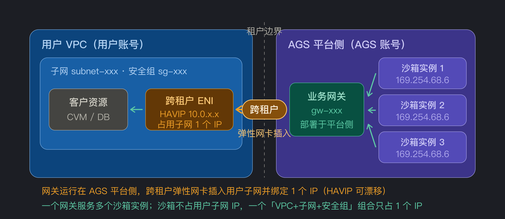
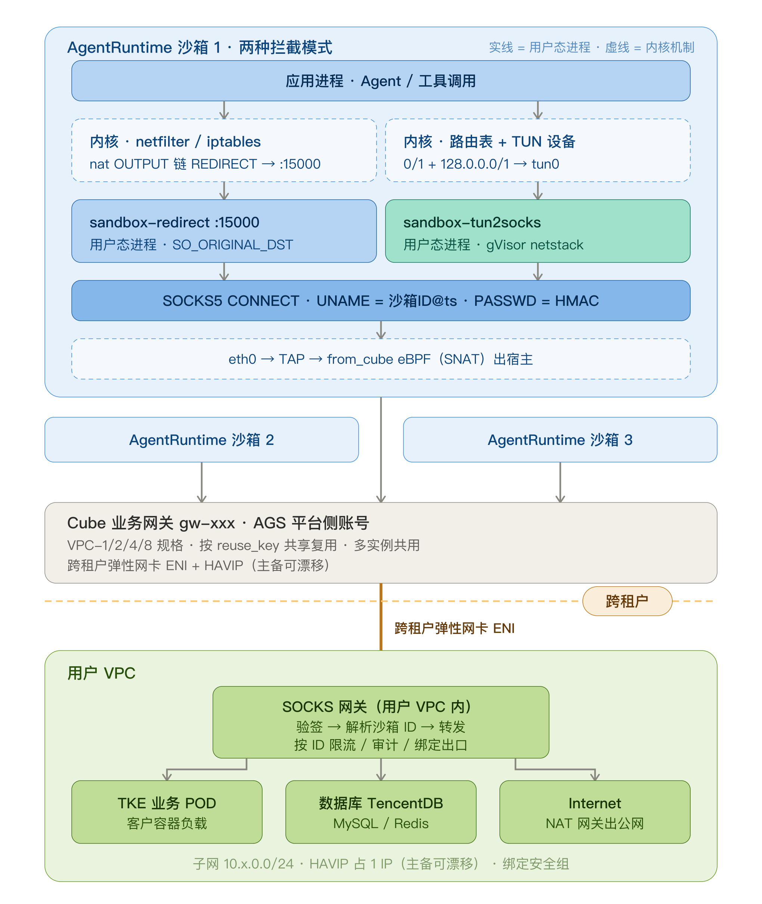

# AGS 沙箱出网代理方案

在 AGS 沙箱内把出网流量经外部 SOCKS5 网关转出，**SOCKS5 认证子协商携带沙箱 ID 与 HMAC 签名**，网关按 ID 做策略/限流/审计并路由到特定出口机器。单一入口、出口池分发。

## 背景

同一沙箱工具的多个沙箱实例共用同一个网关出口 IP，目标业务侧**无法再通过源 IP / 网卡区分**具体是哪个沙箱发来的请求。



本方案结合 **iptables REDIRECT** 或 **TUN 策略路由**，在 SOCKS5 认证子协商里携带沙箱 ID + HMAC 签名，**自定义 SOCKS 网关解析后即可按沙箱做区分处理**（路由到指定出口、按 ID 限流、审计归因）。



## 凭证协议

RFC 1929 用户名口令子协商（不改协议，任何 socks 服务端可解析）：

```
UNAME  = "<sandboxID>@<unixTS>"
PASSWD = base64url( HMAC-SHA256(secret, UNAME) )
```

时间戳参与签名，网关校验 `|now-ts| <= max_skew_seconds`（默认 300s）防重放。**只传 ID 不签名 = 任何人可伪造别人身份，禁止**。

## 组件

| 路径 | 角色 |
|---|---|
| `common/socks5/` | SOCKS5 客户端拨号 + HMAC 凭证构造/校验（双方共用） |
| `sandbox-tun2socks/` | 沙箱内客户端 · TUN 模式（gVisor netstack，不依赖 iptables） |
| `sandbox-redirect/` | 沙箱内客户端 · iptables 模式（REDIRECT / TPROXY，**推荐**） |
| `gateway/` | 外部 SOCKS5 出口网关（验签、按 ID 路由、限流、审计） |
| `scripts/setup-tun.sh` | TUN 模式的设备/路由配置 |
| `scripts/setup-redirect.sh` | iptables 模式规则（含 TPROXY 网关模式） |

## 构建

```bash
go mod tidy        # 首次构建修正 gVisor 版本
go build -o bin/ ./sandbox-tun2socks ./sandbox-redirect ./gateway
```

## 部署

### 1. 网关（公网机器）

```bash
openssl rand -base64 32            # 生成 secret，同时配到网关与沙箱侧
vim gateway/gateway.yaml           # 填 secret、出口池、路由规则
./bin/gateway -config gateway/gateway.yaml
```

### 2. 沙箱内 · iptables 模式（推荐）

```bash
export AGS_SANDBOX_ID="sbx-xxx"                 # 沙箱 ID（注入通道见下）
export AGS_SOCKS_SECRET="<同一个 base64 密钥>"
./scripts/setup-redirect.sh <SOCKS_IP> 1080
./bin/sandbox-redirect -mode redirect -proxy <SOCKS_IP>:1080
```

### 3. 沙箱内 · TUN 模式（镜像无 iptables 时）

```bash
export AGS_SANDBOX_ID="sbx-xxx"
export AGS_SOCKS_SECRET="<同一个 base64 密钥>"
./scripts/setup-tun.sh <SOCKS_IP> 1080
./bin/sandbox-tun2socks -proxy <SOCKS_IP>:1080
```

### 4. 验证

```bash
curl -s https://ifconfig.me            # 应返回出口机器的 IP（out-N 的 bind_ip）
curl -sv https://www.qq.com -o /dev/null 2>&1 | grep -i connected
# 网关侧看审计日志：
tail -f /var/log/ags-egress-proxy-audit.log
# conn id=sbx-xxx dst=1.2.3.4:443 outlet=out-1 up=1234 down=56789
```

## 容器部署

镜像内含三个二进制，运行时按环境变量 `MODE`（`gateway` / `redirect` / `tproxy` / `tun`）选择入口。
镜像：`ags-egress-proxy:latest`

客户端三模式共用环境变量：`AGS_SANDBOX_ID`、`AGS_SOCKS_SECRET`（须与网关 secret 一致）、`AGS_SOCKS_PROXY=ip:port`。

### 启动 SOCKS 代理网关

容器部署：

```bash
docker run -d -p 1080:1080 \
     -e MODE=gateway \
     ags-egress-proxy:latest
```

TKE 部署：

```yaml
apiVersion: apps/v1
kind: Deployment
metadata:
  name: ags-egress-proxy
  namespace: default
  labels:
    app: ags-egress-proxy
spec:
  replicas: 1
  selector:
    matchLabels:
      app: ags-egress-proxy
  template:
    metadata:
      labels:
        app: ags-egress-proxy
    spec:
      containers:
      - name: ags-egress-proxy
        image: ags-egress-proxy:latest
        imagePullPolicy: IfNotPresent
        env:
        - name: MODE
          value: "gateway"
        ports:
        - containerPort: 1080
          protocol: TCP
          hostPort: 1080
```

获取代理的 IP 地址：

```
内网: 10.0.40.202:1080
公网: 43.143.44.152:1080
```

> 网关镜像默认用内置 `gateway.yaml`（示例占位）。生产请用 `-v $PWD/gateway.yaml:/app/gateway.yaml:ro` 挂载真实配置（填 secret、出口池、路由）。

### redirect 模式启动客户端容器

`redirect` / `tproxy` / `tun` 均需 `--cap-add=NET_ADMIN`（改 iptables / 路由）。

```bash
docker run -d --cap-add=NET_ADMIN --name sbx-cn-redirect \
     -e MODE=redirect \
     -e AGS_SANDBOX_ID=sbx-cn-redirect -e AGS_SOCKS_SECRET=U2VjcmV0LU11c3QtQmUtY2hhbmdlZC1tZS0zMi1ieXRlcw== \
     -e AGS_SOCKS_PROXY=43.143.44.152:1080 \
     ags-egress-proxy:latest
```

### tun 模式启动客户端容器

tun 模式额外需要 `--device /dev/net/tun`（宿主须已 `modprobe tun`）。

```bash
docker run -d --cap-add=NET_ADMIN --device /dev/net/tun --name sbx-cn-tun \
     -e MODE=tun \
     -e AGS_SANDBOX_ID=sbx-cn-tun -e AGS_SOCKS_SECRET=U2VjcmV0LU11c3QtQmUtY2hhbmdlZC1tZS0zMi1ieXRlcw== \
     -e AGS_SOCKS_PROXY=43.143.44.152:1080 \
     ags-egress-proxy:latest
```

### 测试

在客户端容器内访问外部地址，流量应经网关转出：

```bash
curl http://10.0.40.44:8080
curl https://www.baidu.com
```

## 两种客户端怎么选

| | iptables REDIRECT/TPROXY | TUN (tun2socks) |
|---|---|---|
| 性能 | **好**（内核 redirect，无用户态 TCP/IP 栈） | 一般（gVisor netstack，吃沙箱 CPU 配额） |
| 依赖 | iptables + 内核 conntrack | 内核 `CONFIG_TUN=y`（AGS 沙箱已内置）+ /dev/net/tun + iptables（conntrack 回程保护） |
| TCP | ✅ | ✅ |
| UDP | REDIRECT 可匹配但本实现不处理 | ❌ |
| 适用 | 镜像有 iptables（大多数） | 需要 TUN 全量导流 / 策略路由的场景 |

沙箱默认 `privileged: true`，两种模式都放得开。

## 关键设计点

1. **防环路**：到 socks 网关自身的连接必须直连。REDIRECT 模式 `iptables -d $SOCKS_IP -j RETURN`；TUN 模式 `ip route add $SOCKS_IP/32 via $GW dev eth0`。漏了就死循环。
2. **保住 AGS 控制面**：AGS 控制面/数据面连接**全部是 inbound**（客户端 → 数据网关 → `from_world` 端口映射 → 沙箱），`from_world` 只 DNAT 目标不改源，沙箱内连接 peer = **数据面网关（e2b-data-gateway）出口 IP**。TUN 全量导流会把这些连接的**回程**吸进 tun0 导致断连。`setup-tun.sh` 已内置两层保护：
   - **conntrack 回程保护（默认）**：`iptables -t mangle OUTPUT -m conntrack --ctstate ESTABLISHED --ctdir REPLY -j MARK --set-mark 100` + `ip rule fwmark 100 table 100` → 所有"非本机发起"的连接回程走原网卡。零配置、自动覆盖新连接。原理：inbound 连接的首包从 eth0 进（ORIGINAL 方向），沙箱回程走 OUTPUT 且是 REPLY 方向；本机应用主动出连始终是 ORIGINAL 方向，不会误匹配。
   - **存量 peer 学习（兜底，无 iptables 时自动启用）**：脚本运行时抓 `ss -Htn state established` 的 peer 逐个 `/32` 直连。只保护存量连接，新 inbound 连接仍可能断。
   - **手工大段（最稳）**：把网关网段写进 `EXCLUDE_CIDRS`。获取方法：
     1. 沙箱内实测（最准）：起一条真实数据面连接（`agr instance exec` 或 SDK），然后
        `ss -Htn state established | grep 49983`（或业务端口）——peer 列即网关出口 IP，`whois`/内部确认所属 /24。
     2. 域名反推：`dig +short <port>-<sbid>.sandbox.<域>` 拿到入口 VIP；注意客户端侧 VIP（LVS/CLB）与沙箱侧 real IP 可能不同段，仅作参考。
     3. 平台侧确认：数据网关集群的出口/real IP 段（部署配置或运维口径），适合固化成网段。
   - REDIRECT 模式无此问题：`nat OUTPUT` 只碰 NEW 连接，ESTABLISHED 回程不会被重定向。
3. **DNS 走直连**：TUN 模式把 `/etc/resolv.conf` 里的 DNS IP 加了直连路由。本实现不做 fake DNS——发到网关的目标是 IP（ATYP=0x01），**网关侧只能按 IP 做策略**。要按域名做策略需加 fake IP 映射（后续项）。
4. **MTU 1400**：TUN 模式留出封装余量，避免分片。
5. **限流语义**：`max_conns_per_id` 是每 ID 并发 TCP 连接数，按连接拒绝（SOCKS5 rep=0x02），不是带宽限速。

## 已知限制

- **仅 TCP**。UDP（QUIC/HTTP3、WebRTC、DoU）不经过代理：TUN 模式被 netstack 丢弃，REDIRECT 模式未加 UDP 规则。应用会回退 TCP，属可接受降级。
- **ICMP 不通**（ping 经 tun0 无回应）。
- **无 fake DNS**：网关按 IP 策略；域名策略需扩展。
- **明文传输**：SOCKS5 本身无加密。跨公网部署时建议：网关只放行来自已知出口 IP 的连接（安全组），或套 WireGuard / stunnel。**不要明文跨公网传敏感流量**。
- **IPv6**：netstack 只注册了 ipv4，IPv6 目的会失败。

## 与 AGS 的对位

- 网络治理第三条路：VPC+PrivateEndpoint（官方合规）｜CubeVS eBPF（平台默认）｜**客户自建集中出口**（本方案）。
- 卖点：出网策略从 N 条白名单收敛为 1 个 IP:port；流量在网关按沙箱 ID 归因，可做成本分摊与审计；出口池可给每个沙箱绑定固定出口 IP（爬虫/多租户场景）。
